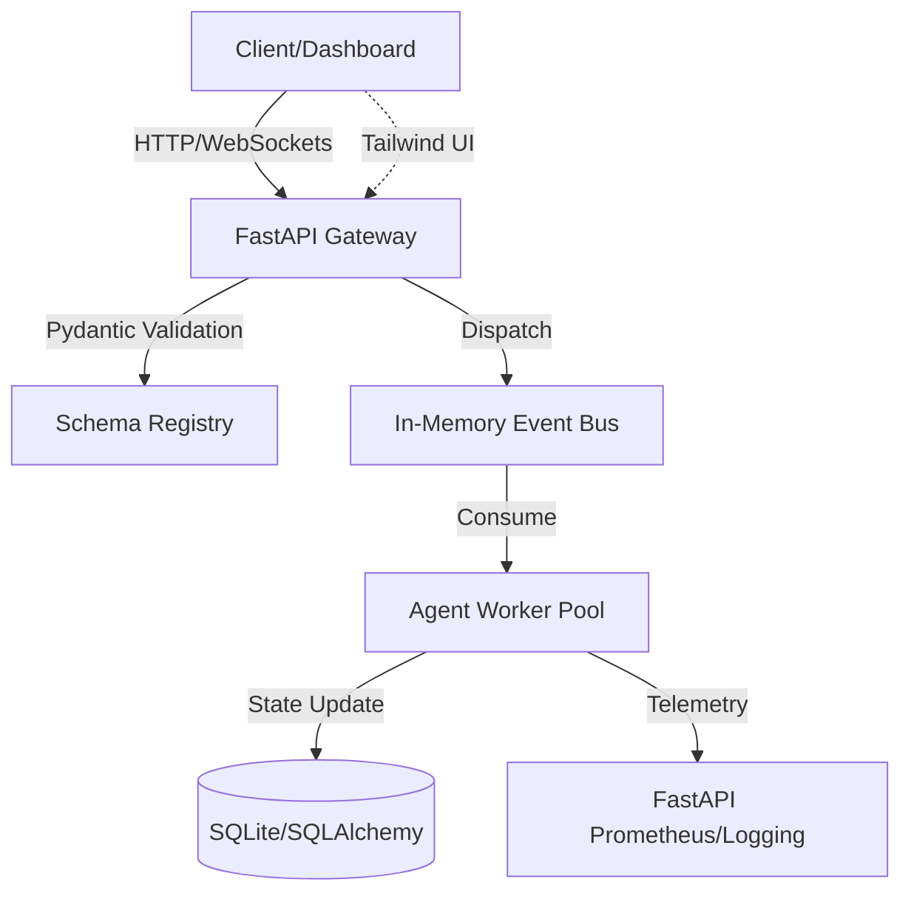

# ARCHITECTURE.md: Agentic-AI 9F64B3

## 1. High-Level System Topology

The system utilizes a decoupled, event-driven architecture where the FastAPI application acts as the ingress/orchestration layer, communicating with an in-memory event bus that dispatches tasks to specialized worker agents.



## 2. Tech Stack Rationale

*   **Python 3.11+**: Utilizes `TaskGroup` for structured concurrency and `Self` type hinting for fluent API design.
*   **Pydantic v2**: Core validation engine. Leverages Rust-based parsing for high-throughput schema enforcement.
*   **FastAPI**: Asynchronous-first framework. Chosen for native OpenAPI integration and dependency injection (DI) patterns.
*   **SQLite (w/ SQLAlchemy 2.0)**: Chosen for local state persistence. Using `aiosqlite` for non-blocking I/O.
*   **Tailwind CSS**: Utility-first CSS for rapid, maintainable dashboard UI without heavy build-step overhead.
*   **In-Memory Event Bus**: Custom `asyncio.Queue` implementation to ensure zero-latency IPC between the API and background workers.

## 3. Module & Directory Layout

```text
/src
├── api/                # FastAPI routes and dependency injection
├── core/               # Event bus, configuration, and base classes
├── models/             # Pydantic v2 schemas (strict validation)
├── agents/             # Logic for specific agent behaviors
├── db/                 # SQLAlchemy models and session management
├── services/           # Business logic layer
├── ui/                 # Tailwind/Jinja2 templates
└── main.py             # Application entry point
```

## 4. Data Flow & Component Interaction

1.  **Ingress**: Requests hit `api/` endpoints. FastAPI invokes Pydantic models to validate the payload immediately.
2.  **Validation**: If validation fails, a `422 Unprocessable Entity` is returned. If successful, the payload is serialized into a `TaskEvent` object.
3.  **Dispatch**: The `EventBus` receives the `TaskEvent`. It maintains a non-blocking queue.
4.  **Execution**: Worker agents (subclassed from `BaseAgent`) pull from the queue. They perform operations and update the `SQLite` state store.
5.  **Telemetry**: Every transition is logged via `structlog` and exposed via FastAPI middleware to track latency and throughput.
6.  **Egress**: The dashboard polls the API or receives updates via WebSockets, rendering the state using Tailwind-styled components.

## 5. Security & Boundary Isolation

*   **Schema Hardening**: All inputs are strictly typed via Pydantic. No dynamic execution of user-provided code is permitted.
*   **Dependency Injection**: All external services (DB, Event Bus) are injected via FastAPI DI, allowing for easy mocking during unit tests.
*   **Memory Safety**: The Event Bus implements a `maxsize` constraint to prevent memory exhaustion (backpressure).
*   **Boundary Isolation**:
    *   **API Layer**: Handles I/O and serialization.
    *   **Domain Layer**: Contains pure business logic; unaware of HTTP context.
    *   **Persistence Layer**: Abstracted behind repository patterns to prevent SQL injection and ensure atomic transactions.
*   **Environment**: Secrets are managed via `pydantic-settings` with strict environment variable mapping. No hardcoded credentials.